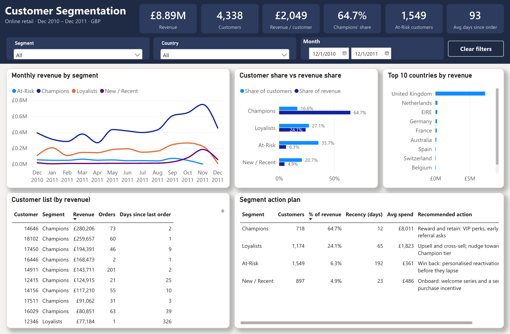

# Customer Segmentation: Power BI dashboard

A Power BI Project (PBIP) on the RFM segments: a one-page dashboard for day-to-day use, detail pages, and an Insights page. Amounts are in pounds sterling (£).

## Pages

| Page | What it shows |
|---|---|
| Dashboard | Header KPIs (revenue, customers, revenue per customer, Champions' share of revenue, At-Risk customers, average days since last order). Filters for segment, country and month. Monthly revenue by segment, customer share vs revenue share, top 10 countries, a customer list ranked by revenue, and the segment action plan. |
| Recency vs Spend | One point per customer: days since last purchase vs total spend (log scale), coloured by segment. |
| Revenue Trends | Monthly revenue by segment and revenue by country. |
| Segment Actions | Segment profiles with a recommended action for each. |
| Insights | Key findings. |

## Open it

1. Run `python3 rebuild_rfm.py "Online Retail.xlsx"` from the repo root. Besides the RFM tables, it writes `rfm_segments.csv` (one row per customer with its segment) and `clean_transactions.csv` (392,689 cleaned sales lines).
2. Open `Customer-Segmentation.pbip` in Power BI Desktop.
3. Go to **Transform data → Edit parameters** and set `DataFolder` to the folder that holds the two CSVs, ending with a backslash (for example `C:\Users\you\Customer-Segmentation-Retail-Analysis\`). Then refresh.

Power Query joins the two files on `customer_id`, so each sales line carries its customer's recency, frequency, spend and segment.

## Main measures

| Measure | DAX |
|---|---|
| Revenue | `SUM(line_item_total)` |
| Customers | `DISTINCTCOUNT(customer_id)` |
| % of Revenue | `DIVIDE([Revenue], CALCULATE([Revenue], ALL(segment)))` |
| % of Customers | `DIVIDE([Customers], CALCULATE([Customers], ALL(segment)))` |
| Avg Recency (days) | Average over customers of days since their last purchase |
| Avg Spend | Average over customers of total spend |
| Recommended Action | Action text for the selected segment |

Expected totals: £8.89M revenue, 4,338 customers. Champions are 718 customers with 64.7% of revenue. Dec 2011 is a partial month (the data ends on 9 Dec 2011).
